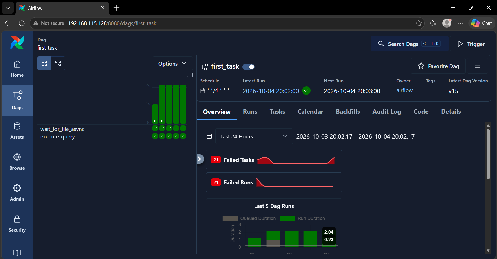
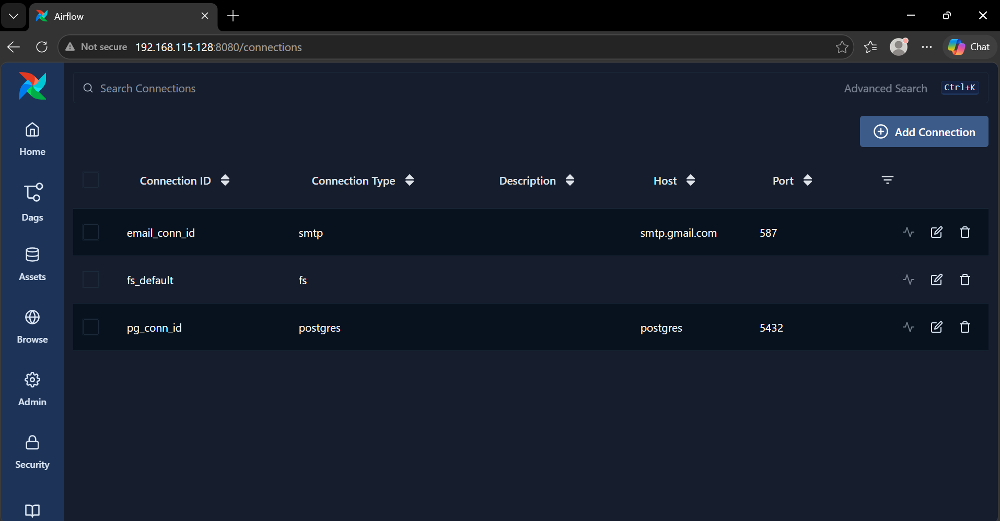
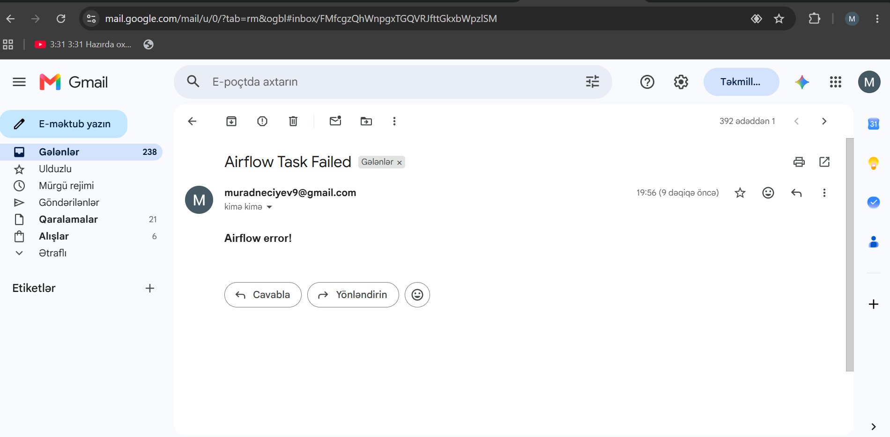

# Airflow Project 1

Docker üzərində **Apache Airflow 3.1.0 + PostgreSQL 16 + MinIO** ilə qurulmuş sadə pipeline. DAG `orders.csv` faylını gözləyir, PostgreSQL-də `orders` cədvəlini yenidən yaradır və fayldakı məlumatları yükləyir. Xəta olduqda e-poçt bildirişi göndərilir.

## Struktur

```
airflowproject1/
├── airflow/
│   ├── dags/taskdag.py     # DAG: first_task
│   └── files/orders.csv    # Tab ayırıcılı data faylı
├── screenshot/
├── docker-compose.yml
├── Dockerfile
└── requirements.txt
```

## DAG: `first_task`

```
wait_for_file_async (FileSensor)  >>  execute_query (SQLExecuteQueryOperator)
```

- `FileSensor` `/opt/airflow/files/orders.csv` faylını gözləyir
- `execute_query` cədvəli silib yenidən yaradır və `COPY` ilə CSV-ni yükləyir
- 2 retry (5 dəq. fasilə), xəta zamanı SMTP ilə e-poçt (`email_conn_id`)
- Cədvəl: `order_id`, `full_name`, `city`, `registration_date`, `membership_level`

## Servislər

| Servis | Port |
|---|---|
| Airflow UI | 8080 |
| PostgreSQL | 5436 |
| MinIO / Console | 9000 / 9001 |

## İşə salma

```bash
git clone <repo-url>
cd airflowproject1
# .env faylını yaradın (AIRFLOW_IMAGE_NAME, POSTGRES_*, MINIO_ROOT_*)
docker compose up -d --build
```

Airflow UI: http://localhost:8080 (`admin` / `admin`)

## Connection-lar (Admin → Connections)

| ID | Tip | Host | Port | Qeyd |
|---|---|---|---|---|
| `pg_conn_id` | postgres | `postgres` | 5432 | SQL tasklar üçün |
| `email_conn_id` | smtp | `smtp.gmail.com` | 587 | Xəta bildirişləri üçün (Gmail App Password) |
| `fs_default` | fs | - | - | `FileSensor` üçün (Airflow-un default connection-u) |

## Screenshot-lar




